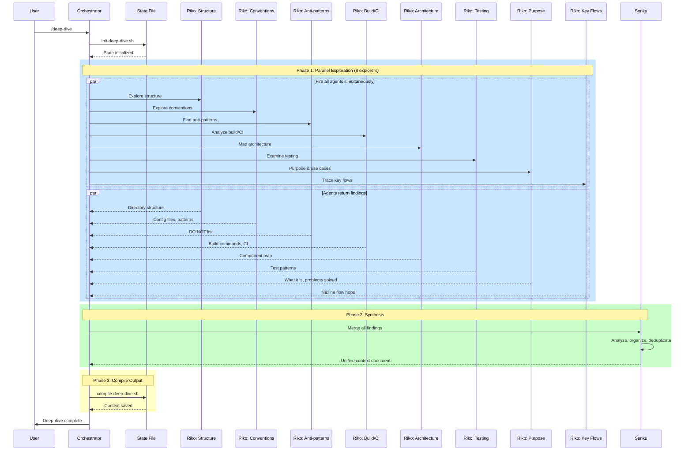
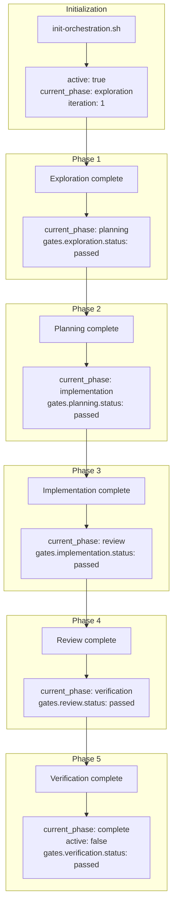
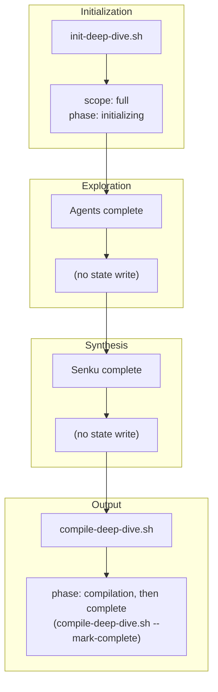
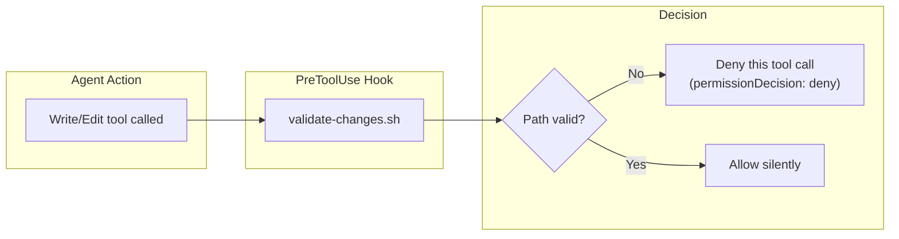
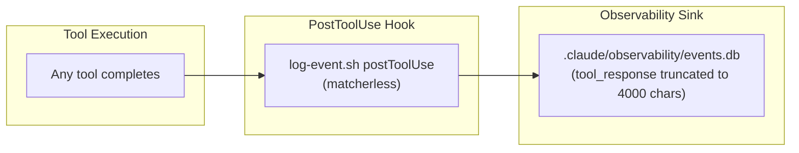
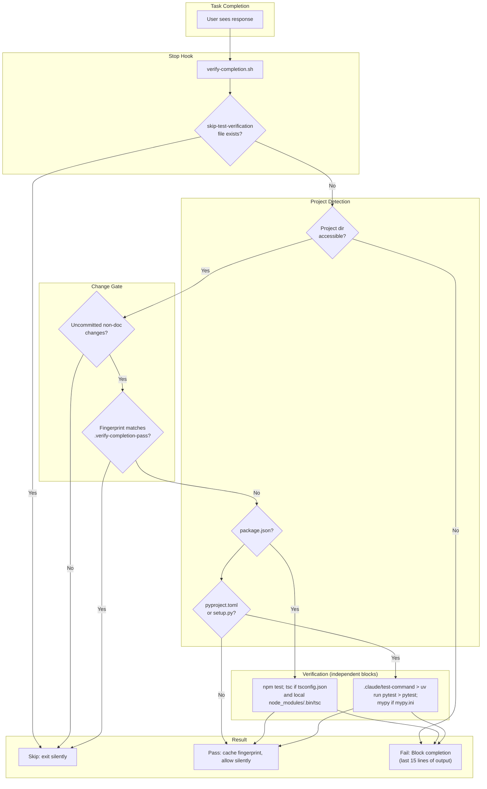
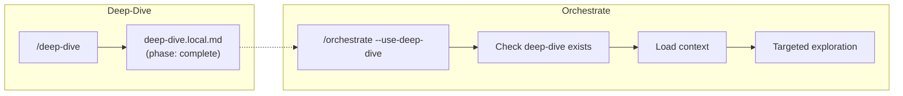
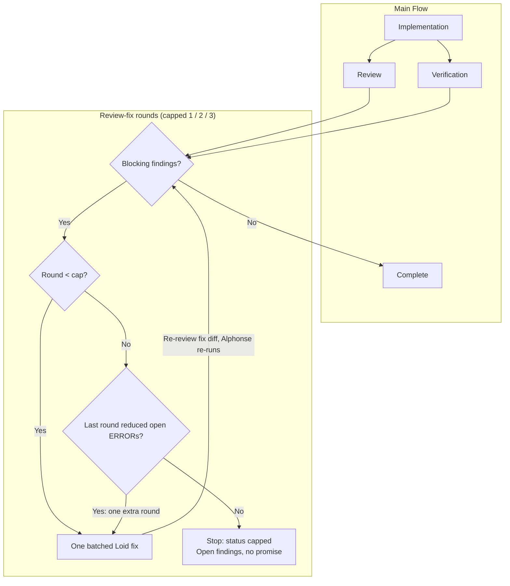

# Data Flows

Detailed sequence diagrams showing how data flows through Agent Flow during orchestration and deep-dive workflows.

## Orchestration Data Flow

### Complete Workflow Sequence

```mermaid
sequenceDiagram
    participant U as User
    participant H as Hooks
    participant O as Orchestrator
    participant ST as State File
    participant R as Riko
    participant S as Senku
    participant L as Loid
    participant LW as Lawliet
    participant A as Alphonse
    participant CX as Codex (optional)

    %% Initialization
    U->>O: /orchestrate "Add auth feature"
    O->>H: UserPromptSubmit
    H->>H: Deterministic gate (skip / nudge)
    H-->>O: additionalContext nudge (only for new unscoped prompts)
    O->>ST: init-orchestration.sh
    Note over O,ST: init-orchestration.sh calls detect-graph-context.sh,<br/>detect-personal-kb.sh, and detect-agentsview-context.sh,<br/>writing graph + personal_kb + agentsview blocks into state
    ST-->>O: State initialized (with graph/personal_kb/agentsview context blocks)

    Note over O: Execution profile chosen (fast / standard / thorough).<br/>Phases 1-2 are skipped under fast, and for trivial under standard

    %% Phase 1: Exploration
    rect rgb(200, 230, 255)
        Note over O,R: Phase 1: Exploration
        O->>R: Task: Explore codebase
        R->>R: Glob, Grep, Read
        R-->>O: Findings (files, patterns)
        O->>ST: update-state --phase planning
    end

    %% Phase 2: Planning
    rect rgb(200, 255, 200)
        Note over O,S: Phase 2: Planning
        O->>S: Task: Create plan<br/>(includes Riko findings)
        S->>S: Analyze, write numbered checklist plan
        S-->>O: Implementation plan
        O->>ST: update-state --phase implementation
    end

    %% Phases 3-5 as a workflow
    rect rgb(255, 245, 220)
        Note over O,A: Phases 3-5: implement-review-verify workflow
        O->>L: Task: Implement plan
        L->>H: PreToolUse (Write/Edit)
        H-->>L: Allowed
        L->>L: Write, Edit, targeted checks
        L-->>O: Changes made
        par Phase 4: Review
            O->>LW: Review (type check, lint, patterns, intent)
            LW-->>O: APPROVED or NEEDS_CHANGES
        and Codex (optional)
            O->>CX: dispatch-codex-review.sh
            CX-->>O: Verdict + file:line findings
        and Phase 5: Verification
            O->>A: Tests and build
            A-->>O: VERIFIED, FAILED or ENVIRONMENT_BLOCKED
        end
        alt blocking findings and round < cap
            O->>L: One batch of all ERROR/WARNING findings
            L-->>O: Fixed
            Note over O,A: Lawliet and Codex re-review the fix diff; Alphonse re-runs
        end
        Note over O: Returns status: complete, capped, escalation, divergence or blocked
    end

    O->>ST: update-state --complete

    %% Completion
    O->>H: Stop hook
    H->>H: verify-completion.sh
    H-->>O: Gates passed
    O->>U: TASK VERIFIED (a capped run lists Open findings instead)
```

### Data Passed Between Phases

| From | To | Data |
|------|-----|------|
| User | Orchestrator | Task description |
| Hooks | Orchestrator | additionalContext nudge (optional) |
| Orchestrator | State | Phase transitions, gate results |
| init-orchestration.sh | State | `task_complexity: "unclassified"` + `intent:` object (seeded at init) |
| Phase 0 (Prompt Refinement) | State | `task_complexity` tier + `intent` fields persisted via `--set-task-complexity` / `--set-intent-*` |
| detect-graph-context.sh | State | `graph:` block (available, path, nodes, edges, communities) |
| detect-personal-kb.sh | State | `personal_kb:` block (available, path, graph_path, nodes) |
| detect-agentsview-context.sh | State | `agentsview:` block (available, binary, archive_reachable) |
| detect-codex-context.sh | State | `codex:` block (available, binary, auth_present); init runs it alongside the other detectors |
| Riko | Orchestrator | Files, patterns, architecture |
| Orchestrator | Senku | Task + Riko's findings + **intent payload (verbatim, no re-summarization)** |
| Senku | Orchestrator | Implementation plan + `<plan-interpretation>` block |
| Orchestrator | Workflow | `intent`, `plan`, `profile`, `codex`, `codex_available`, `state_file`, `plugin_root`, optional `prior_findings` / `start_round` / `preambles` (`workflows/implement-review-verify.js`) |
| Workflow | Loid | Plan (or intent when Phases 1-2 were skipped) + **intent payload (verbatim)** |
| Loid | Workflow | Changed files + targeted check results |
| Workflow | Orchestrator | `status` (`complete`/`capped`/`escalation`/`divergence`/`blocked`), `open_findings`, `rounds_used` |
| Workflow | Lawliet | Changed files list (fix diff on re-review) + **intent Goal + Constraints** |
| Lawliet | Workflow | Review verdict + issues (including `intent-mismatch` if applicable) |
| Workflow | Codex | Diff + rubric via `dispatch-codex-review.sh` |
| Codex | Workflow | Verdict + `file:line` findings |
| Workflow | Alphonse | Full codebase |
| Alphonse | Workflow | Verification evidence (tests, build) |

## Deep-Dive Data Flow

### Parallel Exploration Sequence



### Data Gathered by Each Agent

| Agent | Explores | Output |
|-------|----------|--------|
| Structure | Directory layout | Entry points, packages, organization |
| Conventions | Config files | Naming patterns, style rules |
| Anti-patterns | Comments, docs | DO NOT list, warnings |
| Build/CI | Scripts, workflows | Test commands, CI pipeline |
| Architecture | Source code | Component map, dependencies |
| Testing | Test files | Framework, patterns, utilities |
| Purpose & Use Cases | README, docs, examples | What it is, problems solved, adoption modes |
| Key Flows | Source code | Numbered `file:line` hops per flow, failure notes |

## State File Data Flow

### Orchestration State Updates



### Deep-Dive State Updates



## Hook Data Flow

### PreToolUse Flow



### PostToolUse Flow



PostToolUse (like SubagentStop and SessionEnd) only logs events for observability; it does not verify or block anything. The former `Agent|Task` prompt hook was removed because it cost a Haiku call per subagent and falsely blocked background agents.

### Stop Hook Flow



## Integration Points

### Deep-Dive to Orchestrate



### Iteration Loop



## Related Documentation

- [Architecture Overview](overview.md) - System design
- [Commands Reference](../reference/commands.md) - Command specifications
- [Hooks Reference](../reference/hooks.md) - Hook system details
- [State Files Reference](../reference/state-files.md) - State file formats
