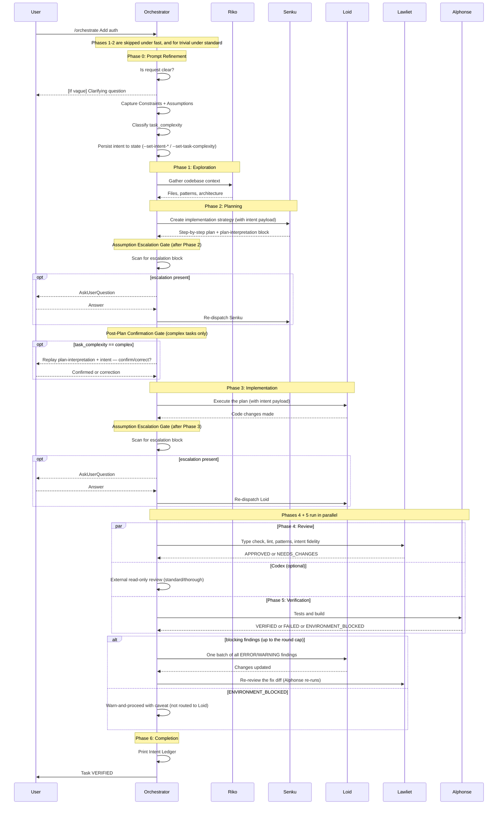

# Using Orchestrate

A practical guide to executing complex multi-step tasks with the `/orchestrate` command.

## What is Orchestrate?

Orchestrate is a multi-agent workflow that coordinates specialists to complete complex development tasks. Instead of a single agent attempting everything, orchestrate delegates to experts:

1. **Riko** explores the codebase
2. **Senku** creates an implementation plan
3. **Loid** implements the changes
4. **Lawliet** reviews code quality
5. **Alphonse** verifies everything passes

Which phases run depends on the [execution profile](#execution-profiles): small tasks skip exploration and planning.

## When to Use Orchestrate

### Good Use Cases

- **New feature implementation**: Multiple files need changes
- **Bug fixes requiring investigation**: Root cause unknown
- **Refactoring**: Changes affect multiple components
- **Cross-cutting concerns**: Auth, logging, error handling

### When to Skip

- **Simple questions**: "How does X work?"
- **Single-file fixes**: Known location, clear solution
- **Exploration only**: Use `/deep-dive` instead

## Basic Usage

### Simple Orchestration

```
/orchestrate Add user authentication with JWT tokens
```

### With Deep-Dive Context

```
/orchestrate --use-deep-dive Add user profile page
```

Use `--use-deep-dive` when you've previously run `/deep-dive` to accelerate exploration.

## Execution profiles

The orchestrator picks an execution profile from the task's tier and risk; there are no flags. `fast` (trivial, or a localized 1–2 file change) skips Riko, Senku and Codex; `standard` skips Riko and Senku only for trivial tasks; `thorough` (complex, or anything touching auth, security, payments, migrations, concurrency or a public API) runs everything. Review-fix rounds are capped at 1 / 2 / 3. A run can move up a profile mid-way, never down. Research and exploratory tasks take a **report-only** route: a written report, no Phases 3–5.

| | fast | standard | thorough | report-only |
|---|---|---|---|---|
| Phase 1 Riko | skip | skip for `trivial` | always | always |
| Phase 2 Senku | skip | skip for `trivial` | always | always, except plain exploratory |
| Phase 4 Lawliet | yes | yes | yes | — |
| Phase 4 Codex | skip | yes (if available) | yes (if available) | — |
| Phase 5 Alphonse | yes | yes | yes | — |
| Max review-fix rounds | 1 | 2 | 3 | n/a |

### Research Short-Circuit (report-only route)

When your task is classified `research` or `exploratory`, or `report_requested=true` is set in state (Phase 0, when you explicitly ask for a written report, investigation guide, or planning document), `/orchestrate` takes the report-only route: Riko (and Senku unless the tier is plain `exploratory`), then a durable markdown report. Phases 3–5 and Post-Plan Confirmation are skipped.

#### Worked Example

```
User: /orchestrate investigate why auth tokens expire early
```

The orchestrator classifies this as `research`, runs Riko (Phase 1) and Senku (Phase 2, required for a `research` report's recommendations) to gather findings, then writes the report:

```
[Research Short-Circuit triggered — task_complexity: research]

Initializing report...
Compiling findings...

<research-report-complete>REPORT WRITTEN: .claude/research-investigate-why-auth-tokens-expire-ear-20260612T093000Z.local.md</research-report-complete>
```

The report at `.claude/research-investigate-why-auth-tokens-expire-ear-20260612T093000Z.local.md` is:

- **Gitignored** — covered by the `.claude/*.local.*` pattern in agent-flow's managed `.gitignore` block.
- **Durable** — persists beyond the session, multiple reports accumulate (no auto-cleanup).
- **Human-readable** — standard markdown with YAML frontmatter.

You can open the file directly or copy it elsewhere for reference.

## Phases 3–5 run as a workflow

When the Workflow tool is available, Phases 3–5 run as the `agent-flow:implement-review-verify` workflow, which returns one of: `complete` (go to the report), `capped` (report with Open findings, no completion promise), `escalation` (Loid hit a contradicted assumption; you're asked, then it relaunches), `divergence` (Codex alone keeps citing the same findings two rounds running; you choose Accept Codex / Accept Lawliet / give guidance, default Lawliet), `blocked` (surfaced to you). Without the Workflow tool the orchestrator follows the same rules turn by turn.

## The Orchestration Workflow



## Phase Details

### Phase 0: Prompt Refinement

Before work begins, the system ensures your request is clear.

**If your request is vague:**
```
User: /orchestrate make the auth better

Claude: I'd like to clarify your request. What aspect of authentication
should I improve?

1. Add new auth method (OAuth, SSO, MFA)
2. Fix security vulnerabilities
3. Improve performance
4. Refactor for maintainability

Please specify, or I'll proceed with option 4 (refactoring).
```

**If your request is clear:**
```
User: /orchestrate Add OAuth2 login with Google provider

Claude: Task understood. Beginning orchestration...

**Goal**: Add OAuth2 authentication with Google
**Description**: Integrate Google OAuth2 provider for user login
**Actions**:
- Configure Google OAuth credentials
- Add OAuth routes and handlers
- Update user model for OAuth data
- Add frontend login button
**Constraints**: Must not break existing session handling
**Assumptions**: Google OAuth credentials already provisioned in the environment

task_complexity: implementation
```

The structured intent (Goal, Description, Actions, Constraints, Assumptions) and `task_complexity` are persisted to `.claude/orchestration.local.md` via `--set-intent-*` / `--set-task-complexity` flags and passed **verbatim** (no re-summarization) to Senku and Loid.

Between Phase 2 and Phase 3, for `complex` tasks only, the orchestrator replays Senku's `<plan-interpretation>` block alongside the captured intent for your confirmation. Non-complex tasks skip this step (logged as `info:`).

### Phase 1: Exploration

Riko gathers context about your codebase.

- **Ticket intake:** if the request contains an issue key (e.g. `ABC-123`) or a Jira/GitHub issue URL and a matching tool is available, the orchestrator fetches the ticket first and seeds the intent from it.
- **Clarification:** Riko cannot ask you questions; if it needs one, the orchestrator asks it once before planning.
- **Context preambles:** when the knowledge graph, personal KB or AgentsView is available, hints are added to Riko, Senku and Lawliet prompts. See [Using Graphify](using-graphify.md), [Using Personal KB](using-personal-kb.md) and [Using AgentsView](using-agentsview.md).
- **Long reports:** agent reports over ~3000 characters are written to `.claude/agent-reports/` and relayed by path.

**What Riko finds:**
- Relevant files and their locations
- Existing patterns and conventions
- Architecture and dependencies
- Similar implementations to follow

**Output example:**
```markdown
## Exploration Results

### Key Files
- `src/auth/login.ts:45-67` - Current login implementation
- `src/middleware/auth.ts:12-30` - Auth middleware
- `src/config/auth.ts:5-20` - Auth configuration

### Patterns Found
- **Auth pattern**: JWT-based with refresh tokens
- **Route pattern**: Express router in `src/routes/`
- **Config pattern**: Environment-based in `src/config/`

### Recommendations
- Add OAuth handler in `src/auth/oauth.ts`
- Extend config in `src/config/auth.ts`
- Add routes in `src/routes/auth.ts`
```

### Phase 2: Planning

Senku creates a detailed implementation strategy.

**What Senku produces:**
- Files to modify (with verification they exist)
- Step-by-step implementation plan
- Risks and mitigations
- Verification criteria

**Output example:**
```markdown
## Implementation Plan

### Files to Modify
| File | Changes |
|------|---------|
| src/config/auth.ts | Add OAuth config |
| src/auth/oauth.ts | New OAuth handler |
| src/routes/auth.ts | Add OAuth routes |
| src/types/user.ts | Extend user type |

### Implementation Steps
1. Add Google OAuth configuration
2. Create OAuth handler with token exchange
3. Add OAuth callback route
4. Update user model for OAuth data
5. Add tests for OAuth flow

### Deliverable Output Contract
- **Target format**: New file `src/auth/oauth.ts` plus modifications to `src/routes/auth.ts` and `src/types/user.ts`
- **Acceptance criteria**:
  - Google OAuth callback route returns valid session cookie
  - User record includes `oauth_provider` and `oauth_id` fields after first login
  - All existing auth tests continue to pass
- **Risk / edge cases**:
  - State parameter must be validated to prevent CSRF attacks
  - Refresh token rotation must not invalidate active sessions

### Risks
- **Token storage**: Mitigate with secure httpOnly cookies
- **State validation**: Implement CSRF protection
```

### Phase 3: Implementation

Loid executes the plan, making incremental changes.

**What Loid does:**
- Follows Senku's plan precisely
- Makes changes one file at a time
- Runs targeted checks on changed code (Alphonse runs the full suite)
- Reports any blockers immediately

### Phase 4: Review

Lawliet checks code quality through static analysis.

**What Lawliet checks:**
- Orient via `graph_stats` + `god_nodes(top_n=5)` (mandatory when change touches >1 file/module)
- Type safety (tsc --noEmit, mypy)
- Code style (ESLint, Ruff)
- Security concerns (npm audit, bandit)
- Pattern adherence

**Codex co-review (when available):** When the Codex CLI is installed and authenticated, under the standard and thorough profiles the orchestrator enlists it as a second reviewer alongside Lawliet via `scripts/dispatch-codex-review.sh`. The two verdicts are reconciled per the disagreement protocol (any cited Lawliet ERROR/WARNING blocks, even under APPROVED; Codex flips the verdict only with a `file:line`-cited ERROR/WARNING). See [Using Codex Co-Review](using-codex-review.md) for setup, data-boundary guidance, and the `AGENT_FLOW_NO_CODEX=1` opt-out.

**Possible outcomes:**

**APPROVED:**
```markdown
## Code Review

### Summary
OAuth implementation follows existing patterns and passes all checks.

### Verdict: APPROVED
```

**NEEDS_CHANGES:**
```markdown
## Code Review

### Issues Found
- WARNING: src/auth/oauth.ts:34: missing input validation
- INFO: src/auth/oauth.ts:52: inconsistent error handling in callback

### Verdict: NEEDS_CHANGES
```

When the final verdict is NEEDS_CHANGES — including an APPROVED review that still lists a cited ERROR/WARNING — orchestration loops back to Loid.

**Divergence Cap:** If Lawliet keeps approving with no cited ERROR/WARNING findings but Codex keeps citing the same set of `file:line`s while verification is clean across rounds, the orchestrator counts these "divergence rounds" in state (`codex_divergence_rounds`). After 2 consecutive same-citation rounds, it stops re-dispatching Loid and asks you directly (Accept Codex / Accept Lawliet / provide guidance — defaults to Lawliet if unanswered) rather than looping indefinitely. On the workflow path this returns `status: divergence`.

**Dispatch Recovery:** If any agent dispatch (Riko/Senku/Loid/Lawliet/Alphonse) returns a transport error or a completely empty reply, the orchestrator silently retries that one dispatch once before surfacing anything to you. Read-only agents are always safe to retry; Loid is only retried if no partial file write landed from the failed attempt.

### Phase 5: Verification

Alphonse runs verification in parallel with Lawliet (and Codex, when the profile includes it), because none of them writes code. Lawliet runs type check and lint; Alphonse runs tests and build and reports type/lint as `COVERED (Lawliet)`. Run on its own, Alphonse runs all four gates.

**Output example:**
```markdown
## Verification Results

### Tests
- Status: PASS
- Output: 47/47 tests passed

### Type Check
- Status: COVERED (Lawliet)

### Lint
- Status: COVERED (Lawliet)

### Build
- Status: PASS
- Output: Build successful

### Overall: VERIFIED
```

If any gate fails with a real code defect (`FAILED`), orchestration loops back to Loid with specific errors. If Alphonse instead reports `ENVIRONMENT_BLOCKED` (a gate failed solely due to an interpreter/dependency-version/environment mismatch the change did not introduce), the orchestrator does **not** route back to Loid — it warns and proceeds to completion, recording the blocker as a caveat in the Intent Ledger.

### Phase 6: Completion

Once every gate passes (or the only open gate is `ENVIRONMENT_BLOCKED`), the orchestrator writes the summary inline, following the `evidence-driven-work` reporting shape (`skills/evidence-driven-work/references/expression.md`): outcome first, then background, what changed, impact and purpose, evidence with exact identifiers, terms explained, and what was not done and why. The Intent Ledger and the completion promise come after it:

```
Done: users can now sign in with Google; all 47 tests pass.

Background: the app only had email/password login, and the Goal asked for
Google sign-in without breaking existing sessions.

What changed: an OAuth2 flow (the protocol Google uses to let a site act on a
user's behalf) in src/auth/oauth.ts (new), wired into src/routes/auth.ts and
src/config/auth.ts; the User type gains a provider field (src/types/user.ts).
Tokens live in httpOnly cookies, and the flow carries a CSRF state check.

Impact: existing email/password sessions are untouched (session tests pass);
new tests in src/__tests__/oauth.test.ts cover the login and callback paths.

Evidence: tests 47/47 passed and build successful (Alphonse); types and
lint clean (Lawliet).

Not done: no other providers (out of scope). Pending: production OAuth
credentials, which the Assumptions say are already provisioned.

## Intent Ledger (abbreviated — full template in `intent-ledger.md`)

- Goal: Add OAuth2 authentication with Google
- Constraints: Must not break existing session handling
- Assumptions: Google OAuth credentials already provisioned
- task_complexity: implementation
- Gap-handlers fired this run: none

<orchestration-complete>TASK VERIFIED</orchestration-complete>
```

A capped run (review-fix rounds exhausted) lists the remaining findings under "Open findings" and gets no completion promise.

When a gate came back `ENVIRONMENT_BLOCKED`, the first line says so ("Done, but the test suite never ran: …"), so a reader who stops there doesn't miss it.

The **Intent Ledger** prints before the completion promise and lists the captured Goal, Constraints, Assumptions, `task_complexity` tier, and which gap-handlers (Assumption Escalation, Post-Plan Confirmation) fired during this run.

## State Tracking

Orchestration progress is tracked in `.claude/orchestration.local.md`:

```bash
# Check current phase
grep '^current_phase:' .claude/orchestration.local.md

# Check iteration count
grep '^iteration:' .claude/orchestration.local.md

# View full state
head -30 .claude/orchestration.local.md
```

## Handling Failures

### Review Failures

When Lawliet finds issues:
1. Specific issues are logged
2. Loid receives the feedback
3. Loid makes corrections
4. Lawliet re-reviews

### Verification Failures

When Alphonse finds failures:
1. Exact errors are captured
2. Loid receives the output
3. Loid fixes the issues
4. Alphonse re-verifies

### Round caps

Every blocking finding (ERROR/WARNING with `file:line`) from Lawliet, Codex and Alphonse goes to Loid in one batch. Re-review covers only the fix diff, and Alphonse re-runs. Rounds are capped at 1 / 2 / 3 by profile. At the cap, one extra round is allowed if the last round reduced the open ERRORs; otherwise the run stops with status `capped` and lists the remaining findings under "Open findings" without the completion promise. The state file's `max_iterations` (default 10) is recorded only; nothing enforces it.

## Best Practices

### 1. Be Specific in Your Request

**Good:**
```
/orchestrate Add password reset with email verification and 24-hour expiry
```

**Less Good:**
```
/orchestrate Add password reset
```

### 2. Use Deep-Dive for Unfamiliar Codebases

```bash
# First time on a codebase
/deep-dive

# Then orchestrate with context
/orchestrate --use-deep-dive Add feature
```

### 3. Let the System Ask Questions

Don't over-specify. If your request is ambiguous, the system will ask clarifying questions.

### 4. Trust the Verification

If orchestration says VERIFIED, the code passes all tests, has no type or lint errors, and builds. Two exceptions are stated in the summary: a capped run lists open findings, and an `ENVIRONMENT_BLOCKED` gate is reported as a caveat.

### 5. Review the Summary

Always read the completion summary:
- What was implemented
- Which files changed
- What verification confirmed

## Troubleshooting

### Orchestration Seems Stuck

Check the current phase:
```bash
grep '^current_phase:' .claude/orchestration.local.md
```

Check iteration count:
```bash
grep '^iteration:' .claude/orchestration.local.md
```

### Tests Keep Failing

The system will attempt to fix failures. If stuck:
- Review the exact error output
- Consider if the task scope is too large
- Break into smaller orchestrations

### Review Keeps Rejecting

If Lawliet repeatedly finds issues:
- Check if codebase has strict lint rules
- Review the specific complaints
- Consider adjusting the approach

## Related Documentation

- [Using Deep-Dive](using-deep-dive.md) - Gather codebase context
- [Commands Reference](../reference/commands.md) - Command specifications
- [Agents Reference](../reference/agents.md) - Agent details
- [The "Subagents LIE" Principle](../concepts/subagents-lie.md) - Why verification matters
